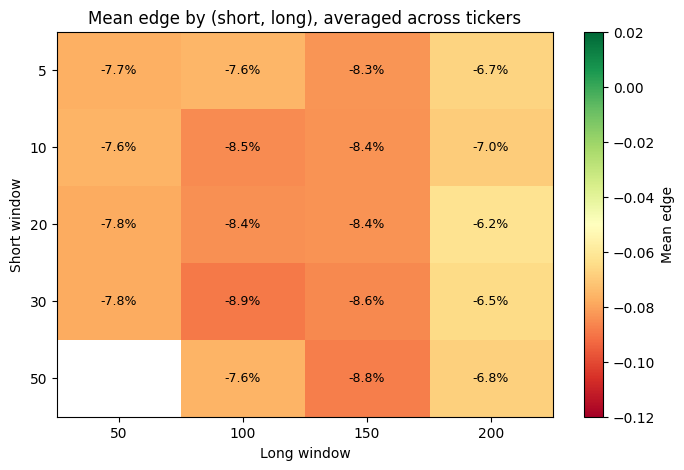

# Moving average crossover backtest: AAPL and a 29-ticker sweep

Python backtest comparing a 20/50-day moving average crossover strategy to buy-and-hold, starting on AAPL and then testing whether that result holds up across 29 tickers and 19 parameter combinations, with a 5 bps transaction cost on every trade, actual historical risk-free rates, and risk-adjusted performance metrics.

## What this is

This project started by testing a simple trend-following strategy against AAPL stock data from 2019 through 2025, comparing it to just buying and holding the stock. The strategy generates a buy signal when a short-term moving average crosses above a long-term moving average, and a sell signal when it crosses below.

One stock and one parameter pair isn't enough to draw a real conclusion from, so v2 adds a sweep: the same strategy run across 29 tickers spanning eight sectors and 19 short/long window combinations each, to check whether the AAPL result is a general property of this kind of strategy or just AAPL's particular price path.

## Result

### AAPL, 20/50: the original test

| | CAGR | Max Drawdown | Sharpe |
|---|---|---|---|
| Buy & Hold | 31.04% | -33.36% | 0.94 |
| Strategy | 18.78% | -28.36% | 0.78 |

The archived v1 notebook reported 31.06%/18.81%. The small difference comes from a one-day CAGR-denominator fix made during the v2 refactor.

Buy-and-hold outperformed the strategy on both raw and risk-adjusted returns. The strategy made 18 round-trip trades over the period and one more position was still open at the end of the data. It spent about 65% of the time in the market. Transaction costs accounted for roughly 1.9% of cumulative return (verified directly in the notebook by comparing results with and without costs), so trading fees explain only a small part of the gap. Most of it comes from days out of the market while the stock was rising.

The numbers come from the price files in `data/`, which were downloaded on 2026-09-02. The code reads those files, so a re-run gives the same numbers.

### The sweep: is AAPL representative?

Turns out this AAPL result wasn't a fluke of that one stock. Across the full sweep (29 tickers × 19 short/long combinations = 551 cells):

- The strategy beat buy-and-hold on CAGR in only **7.3%** of cells, and on Sharpe in **9.4%**.
- AAPL's own 20/50 result sits at roughly the **17th percentile** of the edge distribution. That is worse than about 82% of the cells in the sweep.
- A 95% bootstrap confidence interval on mean edge across tickers comes out to roughly **-9.4% to -6.2%**, entirely below zero.
- Boeing (BA) is the one exception, beating buy-and-hold in 63% of its parameter combinations. I have not checked why Boeing is different. A long/flat rule can help in a long decline by staying out of the market, and with 551 cells one exception can happen by chance (see the multiple-testing item under What's next). Exxon (XOM) wins in 42% and Wells Fargo (WFC) in 26%. Every other ticker, AAPL included, wins in 16% of its combinations or fewer, and 20 of the 29 tickers never beat buy-and-hold in a single one of their 19 combinations.

So over 2019 to 2025, in this ticker universe, the strategy gives up return on AAPL and almost everywhere tested. It does lower risk: its maximum drawdown is smaller than buy-and-hold's in 70.8% of the 551 cells, and its Sharpe ratio is above zero in 67.9%. It mostly trades return for a smaller drawdown. See `2_Sweep_Analysis.ipynb` for the full breakdown, distribution plots, the parameter heatmap, and the per-ticker win rates.

## Filling one day later

The main results assume that each trade is filled at the close of the signal day. That close is also the price the signal is computed from, so a real order could not get exactly that price. I ran the same study again with each trade filled at the next day's close. `sweep_next_close.py` does this and writes `results/sweep_results_next_close.csv`.

For AAPL 20/50 the strategy CAGR goes from 18.78% to 20.45%, the Sharpe ratio from 0.78 to 0.83 and the max drawdown from -28.36% to -23.21%. Buy-and-hold does not change, at 31.04% CAGR. Across the 551 cells the strategy beats buy-and-hold on CAGR in 6.9% of cells (7.3% in the main run) and on Sharpe in 10.3% (9.4%), and 19 of the 29 tickers never beat buy-and-hold on CAGR (20 in the main run). Both shares move by less than 2 percentage points, so the conclusion does not change. I only have daily closes, so I could not test a fill at the next day's open.

## A caveat on the sweep universe: survivorship bias

The 29 tickers in the sweep are today's liquid, still-listed large caps (see `sweep.py` for the list). Anything that was delisted, went bankrupt, or got acquired during 2019 to 2025 isn't in this universe, so it skews toward "the market's winners" rather than a neutral cross-section of everything that existed in 2019. Every ticker is also tested over the exact same 2019 to 2025 window, which was a strong bull run for large-cap US equities generally. The sweep's numbers likely look better than they would for a universe that included delisted firms, and I have not measured by how much. Treat "the strategy loses in this universe, in this window" as the actual finding, not "the strategy loses, full stop."

## Changes in this version

A code review found three problems in `backtest.py`: the first position was NaN, so the entry cost of a strategy that starts long was never charged; buy-and-hold had one more return day than the strategy; and `max_drawdown` took the running peak from the first equity value instead of the starting capital of 1.0. I fixed all three, added `tests/test_backtest.py`, and ran the sweep and both notebooks again on the frozen price files in `data/`. For AAPL 20/50 the strategy CAGR went from 18.80% to 18.78% and the average holding period from 61.8 to 58.5 trading days. Buy-and-hold, the strategy Sharpe ratio (0.78), the strategy max drawdown (-28.36%) and the share of cells where the strategy wins (7.3% on CAGR, 9.4% on Sharpe) did not change.

## What I did

- Pulled daily price data and the 13-week T-bill rate from yfinance, caching both to `data/` so re-running doesn't mean re-downloading every time
- Calculated short/long moving averages and built buy/sell signals from their crossover
- Used the actual historical T-bill rate for idle cash instead of assuming 0% or a flat guess
- Charged a small transaction cost on every trade instead of assuming free trading
- Extracted the backtest logic into `backtest.py` as reusable functions (`load_prices`, `load_risk_free`, `backtest`, `max_drawdown`, `cagr`, `sharpe`, `summarize`, `trade_stats`), so the AAPL notebook and the sweep run the exact same logic instead of two separate implementations that could quietly drift apart
- Ran that same backtest across 29 tickers and 19 short/long combinations each, to check whether the AAPL finding generalizes
- Added a sanity check comparing the implied cost drag against the expected drag from the trade count, to verify the transaction cost logic was actually correct rather than just trusting the output
- Used a ticker-level bootstrap (not a cell-level one) for the sweep's confidence interval. The 19 parameter combinations for one ticker are run on the same price series and are heavily correlated with each other, so treating each of the 551 rows as an independent sample would have understated the real uncertainty
- Added `tests/test_backtest.py`, which checks `backtest.py` on small made-up price series where the answer is known by hand
- Ran the sweep a second time with each trade filled at the next day's close (`sweep_next_close.py`), as an added check on the fill assumption

## Assumptions and limitations

- Long/flat only, no short positions
- Full capital committed on every trade, no partial position sizing
- Fills happen at the closing price of the signal day. A fill one day later is tested in "Filling one day later" above.
- Cash return while out of the market uses the actual historical T-bill rate where available, falling back to a flat 4% estimate if that data can't be pulled
- Prices and T-bill rates are cached to `data/`. The files in this repository were downloaded on 2026-09-02. Delete the cache or pass `refresh=True` to `load_prices`/`load_risk_free` to pull fresh data, which will change the numbers
- Sweep universe has survivorship bias and is tested over a single historical window (see the caveat above)

## File layout

- `backtest.py`: the reusable backtest module (data loading/caching, the strategy itself, and the performance metrics)
- `archive/archive_original_v1.ipynb`: the original AAPL-only notebook, unchanged
- `1_AAPL_Backtest.ipynb`: the same AAPL result, reproduced using `backtest.py` instead of one-off cells
- `sweep.py`: runs the strategy across the 29-ticker × 19-parameter grid and writes `results/sweep_results.csv`
- `results/sweep_results.csv`: one row per (ticker, short, long) cell: CAGR, Sharpe, max drawdown, and edge for strategy vs. buy-and-hold, plus trade stats
- `sweep_next_close.py`: runs the same sweep with each trade filled one day later and writes `results/sweep_results_next_close.csv`
- `results/sweep_results_next_close.csv`: the same columns as `results/sweep_results.csv`, for the fill one day later
- `2_Sweep_Analysis.ipynb`: reads the sweep results and reports the headline numbers, distribution, parameter heatmap, and per-ticker win rates
- `tests/test_backtest.py`: tests for `backtest.py`
- `data/`: the 29 price CSVs and the T-bill CSV used by the code
- `Images/`: the two figures used in this README

## How to run

The price files are in `data/`, so everything runs offline.

1. Clone this repo
2. Install dependencies: `pip install -r requirements.txt`
3. Run `pytest`
4. Open `1_AAPL_Backtest.ipynb` and run all cells for the AAPL-only result (or `archive/archive_original_v1.ipynb` for the original, unrefactored version, which downloads its own prices)
5. Run `python sweep.py` to regenerate `results/sweep_results.csv`
6. Run `python sweep_next_close.py` for the version with fills one day later
7. Open `2_Sweep_Analysis.ipynb` and run all cells to see the sweep results

Tested with Python 3.12.5 on macOS.

## Tools

yfinance, pandas, NumPy, Matplotlib

## What's next

- Walk-forward validation: the 20/50 windows, and every window in the sweep, were picked once and tested on the full history. A more honest test would pick parameters using only past data at each point in time and test forward from there, so results aren't quietly benefiting from hindsight. This is the next planned step.
- Multiple-testing correction: with 551 cells tested, some combinations look good just by chance. Boeing's result should be read with that in mind, not treated as a real edge until it's checked more carefully.
- Multiple signals combined: adding something like RSI sounds like it should help, but it also adds more free parameters, and technical indicators tend to be pretty correlated with each other anyway. The real question is whether it adds anything once the extra parameters are accounted for.
- Position sizing: right now the strategy is either fully in or fully out. A more advanced version might scale position size based on signal strength or volatility, rather than a hard on/off switch.
- A survivorship-bias-free universe: the current sweep only includes tickers that are still liquid and listed today. Testing against a point-in-time universe (including delisted/acquired names) would remove that bias, but needs data this project doesn't currently have.
- Machine learning based signals: with a few thousand daily observations across 29 correlated large-cap stocks, there isn't a lot of independent signal to learn from compared to noise. A flexible model would probably overfit before it actually learned anything useful. If ML shows up here at all, it'd make more sense as a way to combine a few existing signals together under strict walk-forward validation, not as something trying to find patterns directly in raw price data.

## Data source

Prices come from yfinance, called with `auto_adjust=True`, and the code uses the adjusted `Close`. The window is 2019-01-01 up to but not including 2026-01-01. The 29 tickers are the ones listed in `sweep.py` (28 stocks plus SPY): KO, PG, WMT, PEP, COST, XOM, CVX, COP, JPM, BAC, WFC, GS, JNJ, UNH, PFE, ABBV, BA, CAT, HON, UPS, NEE, DUK, SO, LIN, APD, FCX, AAPL, MSFT and SPY. The cash rate is the 13-week T-bill series `^IRX` from yfinance, which `backtest.py` divides by 100 and by 252 to get a daily rate. The files in `data/` were downloaded on 2026-09-02, the date of the files.

## License

MIT License. See the LICENSE file.
