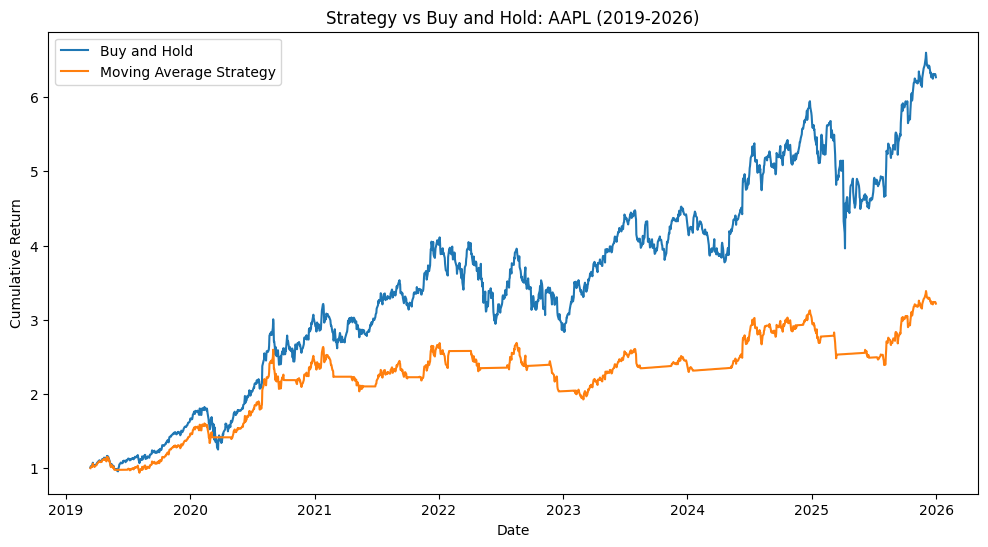
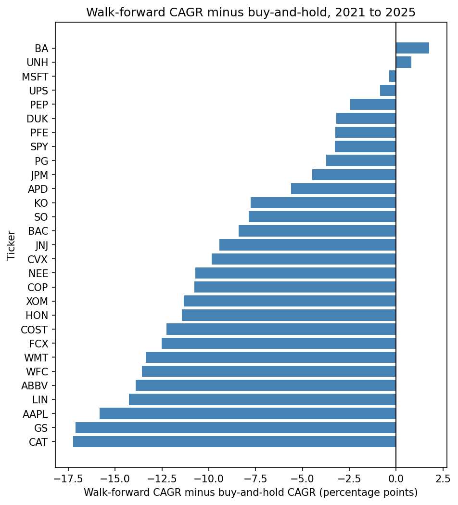
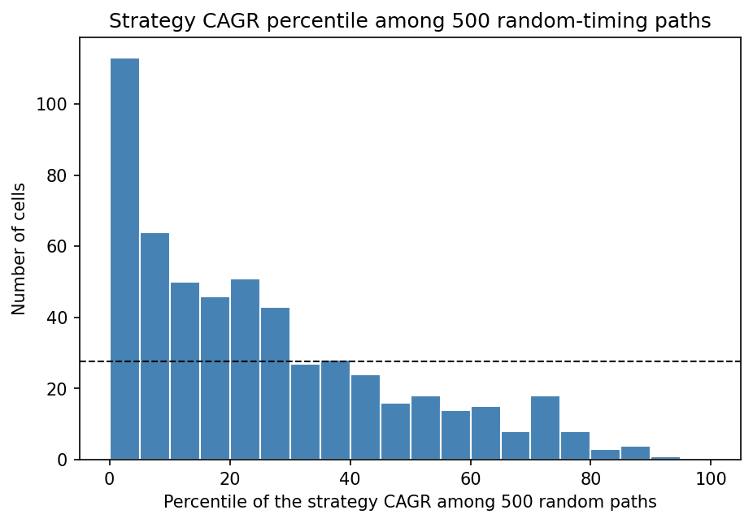

# Moving average crossover backtest: AAPL and a 29-ticker sweep

I test whether a 20/50-day long-or-flat moving average crossover beats buy-and-hold on AAPL, and whether any window pair does across 29 tickers, 19 window pairs and 2019 to 2025. In the sweep of 551 cells, the strategy beats buy-and-hold on CAGR in 7.3% of cells. In a walk-forward test that chooses the window pair each year from past data only (added after the first version), it beats buy-and-hold on Sharpe ratio for 3 of 29 tickers, with a sign test p-value of 1.5e-05. Against random in-and-out timing with the same time in the market (also added after the first version), the median percentile of the strategy's CAGR is 20.0, where 50 would mean no difference. The strategy does lower risk: its maximum drawdown is smaller than buy-and-hold's in 70.8% of cells, so it trades return for a smaller drawdown.

## What I tested

- The AAPL backtest: the 20/50 pair against buy-and-hold, with a 5 bps cost on every trade and the 13-week T-bill rate on cash.
- The sweep: the same backtest on 29 tickers and 19 pairs (551 cells), and again with each trade filled one day later.
- The walk-forward test (added after the first version, plan in `UPGRADE_PLAN.md`): each year from 2021 to 2025, choose the pair with the highest Sharpe ratio over the earlier years, and trade it that year.
- The random-timing benchmark (added after the first version, plan in `UPGRADE_PLAN.md`): 500 random long-or-flat paths per cell with the same time in the market and holding period.

## Results

### AAPL 20/50

| | CAGR | Max drawdown | Sharpe |
|---|---|---|---|
| Buy-and-hold | 31.04% | -33.36% | 0.94 |
| Strategy | 18.78% | -28.36% | 0.78 |

The original notebook in `archive/` reported 31.06% and 18.81%. The small difference comes from a one-day fix to the number of years used in the CAGR.

The figure shows the growth of 1 dollar for both approaches, 2019 to 2025. Buy-and-hold beat the strategy on both raw and risk-adjusted returns. The strategy made 18 round-trip trades and one more position was still open at the end of the data. It spent about 65% of the time in the market. Transaction costs were roughly 1.9% of cumulative return (checked in `1_AAPL_Backtest.ipynb` by comparing results with and without costs), so trading fees explain only a small part of the gap. Most of it comes from days out of the market while the stock was rising.

The numbers come from the price files in `data/`, which were downloaded on 2026-09-02. The code reads those files, so a re-run gives the same numbers.

### The sweep

Across the full sweep (29 tickers x 19 short/long combinations = 551 cells), the AAPL result is not specific to AAPL:

- The strategy beat buy-and-hold on CAGR in 7.3% of cells, and on Sharpe in 9.4%.
- AAPL's own 20/50 result sits at about the 17th percentile of the edge distribution (strategy CAGR minus buy-and-hold CAGR). That is worse than about 82% of the cells.
- A 95% bootstrap interval on the mean edge across tickers is -9.4% to -6.2%, entirely below zero.
- Boeing (BA) is the one exception, beating buy-and-hold in 63% of its parameter combinations. I have not checked why Boeing is different, and with 551 cells one exception can happen by chance (see the multiple-testing item under "What's next"). Exxon (XOM) wins in 42% and Wells Fargo (WFC) in 26%. Every other ticker, AAPL included, wins in 16% of its combinations or fewer, and 20 of the 29 tickers never beat buy-and-hold in a single one of their 19 combinations.

So over 2019 to 2025, in this ticker universe, the strategy gives up return on AAPL and almost everywhere tested. Its maximum drawdown is smaller than buy-and-hold's in 70.8% of the 551 cells, and its Sharpe ratio is above zero in 67.9%. See `2_Sweep_Analysis.ipynb` for the distribution plots, the parameter heatmap and the per-ticker win rates.

The heatmap shows the mean edge over the 29 tickers for each short and long window pair.

Filling one day later. The main results fill each trade at the close of the signal day. That close is also the price the signal is computed from, so a real order could not get exactly that price. `sweep_next_close.py` runs the same study with each trade filled at the next day's close and writes `results/sweep_results_next_close.csv`. For AAPL 20/50 the strategy CAGR goes from 18.78% to 20.45%, the Sharpe ratio from 0.78 to 0.83 and the max drawdown from -28.36% to -23.21%. Buy-and-hold does not change, at 31.04% CAGR. Across the 551 cells the strategy beats buy-and-hold on CAGR in 6.9% of cells (7.3% in the main run) and on Sharpe in 10.3% (9.4%), and 19 of the 29 tickers never beat buy-and-hold on CAGR (20 in the main run). Both shares move by less than 2 percentage points, so the conclusion does not change. I only have daily closes, so I could not test a fill at the next day's open.

### Walk-forward

Added after the first version (plan in `UPGRADE_PLAN.md`). For each ticker and each year Y from 2021 to 2025, I pick the window pair with the highest Sharpe ratio (excess over T-bills) from 2020-01-01 to the end of year Y-1, and trade it during year Y. The test days are 2021 to 2025. The table gives the median over the 29 tickers (`results/walkforward_by_ticker.csv`). The hindsight row is the pair with the highest CAGR over the test days, and I did not record its Sharpe ratio or drawdown.

| Strategy | Median CAGR | Median Sharpe | Median max drawdown |
|---|---|---|---|
| Walk-forward | 3.57% | 0.18 | -36.30% |
| Buy-and-hold | 14.40% | 0.50 | -31.77% |
| Fixed 20/50 | 3.40% | 0.11 | -33.81% |
| Hindsight best pair | 9.89% | not recorded | not recorded |

Walk-forward beats buy-and-hold on Sharpe ratio for 3 of 29 tickers (two-sided sign test, p = 1.5e-05), on CAGR for 2 of 29, and on maximum drawdown for 11 of 29. It beats the fixed 20/50 pair on CAGR for 16 tickers and on Sharpe for 16. The median difference in CAGR against buy-and-hold is -9.42 percentage points, and in Sharpe ratio -0.34. The median difference in CAGR against the hindsight best pair is -7.03 percentage points, so choosing the pair with hindsight flatters the sweep. Even the hindsight best pair has a median CAGR (9.89%) below buy-and-hold (14.40%). The summary is in `results/walkforward_summary.json` and the yearly choices are in `results/walkforward_choices.csv`.

For AAPL, the walk-forward strategy has a CAGR of 0.29%, a Sharpe ratio of -0.05 and a maximum drawdown of -33.08%. Buy-and-hold over the same days has 16.12%, 0.56 and -33.36%. The fixed 20/50 pair has 5.71%, 0.22 and -28.36%. The chosen pair changed 3 times in the 4 year-to-year steps.

The figure shows the walk-forward CAGR minus the buy-and-hold CAGR for each ticker, sorted. 27 of the 29 bars are below zero (walk-forward beats buy-and-hold on CAGR for 2 tickers).

### Against random timing

Added after the first version (plan in `UPGRADE_PLAN.md`). For each of the 551 cells I simulate 500 random long-or-flat paths with the same share of days in the market and the same average holding period as the strategy, using a two-state Markov chain. Each path pays the same 5 bps cost and earns the same cash rate. I record where the strategy's CAGR falls among the 500 random CAGRs. If the crossover signal adds nothing beyond its time in the market, these percentiles are spread evenly from 0 to 100, with a median near 50. A pile-up near 100 means it adds something, and a pile-up near 0 means it does worse than random timing.

All 551 cells were used and none was skipped. The median CAGR percentile is 20.0. In 16.0% of cells the percentile is above 50, in 0.0% above 95 and in 20.5% below 5. The median Sharpe percentile is 19.0. For AAPL 20/50 the CAGR percentile is 42.4. The numbers are in `results/random_benchmark_summary.json` and `results/random_benchmark.csv`.

The histogram is not flat. Most cells are at low percentiles, and the dashed line shows the count expected in each 5-point bin if the percentiles were spread evenly. So the strategy mostly does worse than random timing with the same time in the market. I have not checked why. A check that would help is to split the random paths by year to see when the strategy's entries and exits cost it the most.

## Limits

- Long/flat only, no short positions, and the full capital is committed on every trade.
- Fills happen at the closing price of the signal day. A fill one day later is tested in "The sweep".
- Costs are a flat 5 bps per trade. There is no slippage and no bid-ask spread.
- The 29 tickers are today's liquid, still-listed large caps. Anything delisted, bankrupt or acquired during 2019 to 2025 is not in the universe, so the numbers likely look better than they would with those firms included. I have not measured by how much.
- Everything is tested over one window, 2019 to 2025, which was a strong bull run for large-cap US equities.
- The walk-forward has only 5 test years (2021 to 2025) and a training start in 2020, so the first choice uses one year of data.
- The random paths match the time in the market and the holding period but not when the trades happen.
- Cash earns the 13-week T-bill rate where the data exist, and a flat 4% a year if the download fails.
- Prices and T-bill rates are cached in `data/`. Deleting the cache or passing `refresh=True` pulls fresh data and changes the numbers.

## How to run

Python 3.12.5 on macOS. The price and T-bill data are committed in `data/`, so everything below runs offline. A file is downloaded only if it is missing, and none is. Times were measured on my laptop with another job running.

| Command | What it does | Time |
|---|---|---|
| `python3.12 -m venv .venv` | makes the environment | 1.5 s |
| `pip install -r requirements.txt` | installs the packages | 19 s |
| `python -m pytest -q` | runs the 26 tests | 1.1 s |
| `python sweep.py` | writes `results/sweep_results.csv` | 1.9 s |
| `python sweep_next_close.py` | writes `results/sweep_results_next_close.csv` | 1.9 s |
| `python walkforward.py` | writes the walk-forward results and figure | 2.9 s |
| `python random_benchmark.py` | writes the random-timing results and figure | 10.7 s |
| `python check_consistency.py` | checks every number in this README | 1.3 s |
| open `1_AAPL_Backtest.ipynb` and run all cells | the AAPL result | 3.3 s |
| open `2_Sweep_Analysis.ipynb` and run all cells | the sweep analysis | 2.3 s |

The archived `archive/archive_original_v1.ipynb` downloads its own prices, so I do not run it.

Data. Prices come from yfinance with `auto_adjust=True`, and the code uses the adjusted close. The window is 2019-01-01 up to but not including 2026-01-01. The 29 tickers are the ones in `sweep.py` (28 stocks plus SPY): KO, PG, WMT, PEP, COST, XOM, CVX, COP, JPM, BAC, WFC, GS, JNJ, UNH, PFE, ABBV, BA, CAT, HON, UPS, NEE, DUK, SO, LIN, APD, FCX, AAPL, MSFT and SPY. The cash rate is the 13-week T-bill series `^IRX`, which `backtest.py` divides by 100 and by 252 to get a daily rate. The files in `data/` were downloaded on 2026-09-02.

## Files

- `README.md`: this file.
- `UPGRADE_PLAN.md`: the plan for the walk-forward and random-timing tests, written before their results.
- `LICENSE`: MIT license.
- `requirements.txt`: pinned package versions.
- `.gitignore`: files kept out of version control.
- `backtest.py`: the backtest module (data loading and caching, the strategy, and the performance metrics).
- `sweep.py`: runs the 29-ticker x 19-pair grid and writes `results/sweep_results.csv`.
- `sweep_next_close.py`: the same grid with each trade filled one day later, writes `results/sweep_results_next_close.csv`.
- `walkforward.py`: the walk-forward test.
- `random_benchmark.py`: the random-timing benchmark.
- `check_consistency.py`: checks the numbers in this README against the results.
- `1_AAPL_Backtest.ipynb`: the AAPL result, using `backtest.py`.
- `2_Sweep_Analysis.ipynb`: reads the sweep results and reports the headline numbers, distribution, heatmap and per-ticker win rates.
- `archive/archive_original_v1.ipynb`: the original AAPL-only notebook, unchanged.
- `tests/test_backtest.py`: 15 tests for `backtest.py`.
- `tests/test_walkforward.py`: 5 tests for `walkforward.py`.
- `tests/test_random_benchmark.py`: 6 tests for `random_benchmark.py`.
- `data/`: the 29 price CSVs and the T-bill CSV.
- `results/sweep_results.csv`, `results/sweep_results_next_close.csv`: one row per (ticker, short, long) cell.
- `results/walkforward_by_ticker.csv`, `results/walkforward_choices.csv`, `results/walkforward_summary.json`: walk-forward results.
- `results/random_benchmark.csv`, `results/random_benchmark_summary.json`: random-timing results.
- `Images/equity_curve.png`, `Images/heatmap.png`: figures from the first version.
- `Images/walkforward.png`, `Images/random_percentiles.png`: figures from the added tests.

## What's next

- Multiple-testing correction: with 551 cells tested, some combinations look good just by chance. Boeing's result should not be treated as a real edge until it is checked more carefully.
- Multiple signals combined: adding something like RSI adds free parameters, and technical indicators tend to be correlated with each other. The question is whether it adds anything once the extra parameters are accounted for.
- Position sizing: the strategy is either fully in or fully out. A version could scale the position by signal strength or volatility.
- A survivorship-bias-free universe: testing against a point-in-time universe that includes delisted names would remove that bias, but needs data this project does not have.
- Machine learning signals: with a few thousand daily observations across 29 correlated large-cap stocks, there is little independent signal to learn from. If it is tried, it should combine a few existing signals under walk-forward validation.
